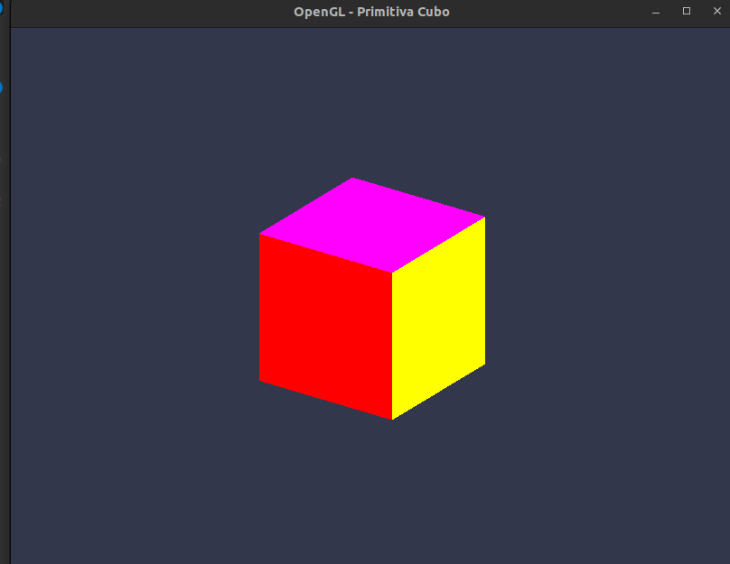

# Practico 2

Se dibujo un cubo, esta vez focalizandose en segmentar un poco las funcionalidades y responsabilidades y que no todo se haga en el `main.cpp`.
De esta manera quedo distribuido asi:

## main.cpp (Orquestador y Punto de Entrada)

`Función principal:` Es el punto central de control de la aplicación.

`Funcionalidades:`
_ Inicializa la ventana y el contexto gráfico con GLFW y carga las extensiones de OpenGL mediante GLAD.
_ Ejecuta el bucle de renderizado (Render Loop), gestionando la tasa de refresco, limpieza de búferes (glClear) e intercambio de fotogramas (Double Buffering). \* Procesa las entradas del usuario y coordina el flujo completo: generación de datos, carga en VRAM, uso de shaders y la llamada de dibujo final (glDrawElements).

## Mesh (Geometría y Recursos de GPU)

`Función principal:` Encapsula la estructura de los datos geométricos y la gestión de memoria en la GPU.

`Componentes y funcionalidades:`
_ Administra el ciclo de vida de los búferes de OpenGL utilizando Direct State Access (DSA):
_ Reserva y libera los identificadores de VAO, VBO y EBO.
_ Sube los datos de vértices e índices a la memoria de la GPU (VRAM).
_ Configura la disposición de los atributos en el VAO para que la GPU sepa cómo interpretar cada byte. \* Expone el conteo de índices (count()) y la manija del VAO para ser enlazada durante el renderizado.

`Cuestiones a pensar de la consigna`

1. ¿Qué guarda count\_: vértices o índices? ¿Cuál de los dos necesita glDrawElements? ¿Y si se quisiera usar Mesh para dibujar una malla no indexada?

- count\_ guarda la cantidad de índices (data.indices.size()).
- glDrawElements necesita el numero de índices a dibujar.
- Malla no indexada: Si no usamos indices, tendriamos que cambiar la función de dibujo a glDrawArrays, la cual necesita la cantidad de vértices. En ese escenario, count\_ debería guardar data.vertices.size().

2. ¿Por qué el objeto movido tiene que quedar en cero, y qué pasaría si no se lo pusiera?

- Porque solo uno puede ser el dueno del objeto, de otra manera si se elimina un obkjeto, se eliminaria su copia tambien

3. Los desplazamientos de cada atributo dentro de la tupla, ¿se escriben a mano (0 y 12) o se calculan? ¿Qué pasa el día que la tupla lleve la normal en el medio?

- Calculamos dinamicamente siempre con offsetof(Vertex, color), para que no se rompa en caso de agregarse la norma l por ejemplo

4. Si mañana el vértice tuviera un atributo más, ¿cuántos lugares del código habría que tocar?

- Vertex.h: Añadir el nuevo campo a la estructura Vertex (ej. glm::vec3 normal;).
- Mesh.cpp (configurarAtributosVAO): Habilitar el nuevo índice de atributo y configurar su formato/binding (glEnableVertexArrayAttrib y glVertexArrayAttribFormat usando su respectivo offsetof).
- El Vertex Shader (.vert): Agregar la nueva entrada en el shader con su layout(location = X) in....

## Shader (Compilación y Pipeline de la GPU)

`Función principal:` Administra la creación, compilación, linkeo y ciclo de vida de los programas ejecutables que corren directamente en la GPU (Program Objects).

`Funcionalidades:`
_ Recibe las cadenas de código fuente GLSL y compila individualmente los módulos (Vertex Shader, Fragment Shader).
_ Verifica errores de sintaxis en tiempo de compilación y fallos de coincidencia de entradas/salidas durante el enlazado (Linking).
_ Activa el programa ejecutable en el contexto de OpenGL mediante use() (glUseProgram).
_ Destruye de forma segura los recursos intermedios tras el linkeo para evitar fugas de memoria en la GPU.

La estructura del proyecto quedo de la siguiente forma:

## Primitives

1. ¿Los colores quedan fijos o son parámetro?
   Quedan fijos en el generador:

```c++
data.vertices = {
            // CARA FRONTAL (+Z) - Color: Rojo
            {-hx, -hy, hz, 1.0f, 0.0f, 0.0f}, // Inferior Izquierda (0)
            {hx, -hy, hz, 1.0f, 0.0f, 0.0f},  // Inferior Derecha   (1)
            {hx, hy, hz, 1.0f, 0.0f, 0.0f},   // Superior Derecha   (2)
            {-hx, hy, hz, 1.0f, 0.0f, 0.0f},  // Superior Izquierda (3)
//(...)
```

Centrado en origen?
Aca centramos en origen:

```c++
  const float hx = scale_x * 0.5f;
    const float hy = scale_y * 0.5f;
    const float hz = scale_z * 0.5f;
```

¿La firma sirve para cylinder/cone?
Sí, la forma del módulo escala sin reescribirse: MeshData cylinder(float radius, float height, int slices) y MeshData cone(float radius, float height, int slices) son solo funciones nuevas en el mismo namespace; se agrega la declaración en el header y nada existente cambia. El único futuro cuello de botella no está en la firma sino en Vertex (Mesh/Vertex.h:3-6): si en otro práctico necesitás normales o UV, cambia el struct del vértice, no el estilo del generador.

```bash
.
├── bin
│   └── ogl-app
├── build
│   ├── gl.o
│   ├── main.o
│   ├── Mesh.o
│   ├── Primitives.o
│   ├── ResourceManager.o
│   └── Shader.o
├── CGyAV-2026-Guia-practico-01.pdf
├── CGyAV-2026-Guia-practico-02.pdf
├── documentacion
│   ├── practico1
│   │   └── practico1.md
│   └── practico2
│       └── practico2.md
├── Makefile
├── Makefile.master
├── shaders
│   ├── shader.frag
│   └── shader.vert
├── src
│   ├── main.cpp
│   ├── Mesh
│   │   ├── Mesh.cpp
│   │   ├── Mesh.h
│   │   └── Vertex.h
│   ├── Primitives
│   │   ├── Primitives.cpp
│   │   └── Primitives.h
│   ├── ResourceManager
│   │   ├── ResourceManager.cpp
│   │   └── ResourceManager.h
│   └── Shader
│       ├── Shader.cpp
│       └── Shader.h
├── test
└── third_party
    └── (...)
```


