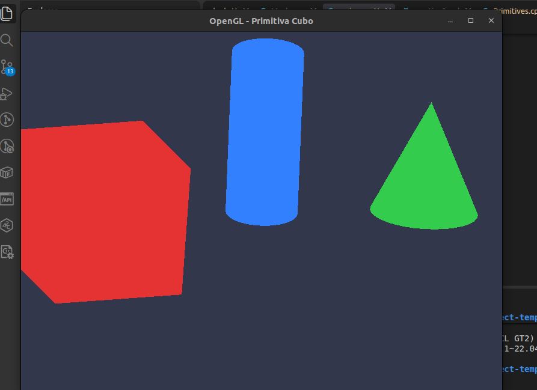

# Practico 3

## Tupla nueva en vertice

### 1. ¿Cuántos lugares del código hubo que tocar para agregar un atributo?

- `Vertex.h`: se agrega el atributo a la tupla

```c++
struct Vertex
{
    glm::vec3 position;
    glm::vec3 normal;
    glm::vec2 tex_coords;
};
```

- `Primitives.cpp`: adaptamos la primitiva con el nuevo atributo

```c++
data.vertices = {
 // CARA FRONTAL (+Z) -> Normal apuntando hacia +Z: {0.0f, 0.0f, 1.0f}
            {{-hx, -hy, hz}, {0.0f, 0.0f, 1.0f}, {0.0f, 0.0f}}, // Inf-Izq (0)
            {{hx, -hy, hz}, {0.0f, 0.0f, 1.0f}, {1.0f, 0.0f}},  // Inf-Der (1)
            {{hx, hy, hz}, {0.0f, 0.0f, 1.0f}, {1.0f, 1.0f}},   // Sup-Der (2)
            {{-hx, hy, hz}, {0.0f, 0.0f, 1.0f}, {0.0f, 1.0f}}  // Sup-Izq (3)
            };
            // (...)
```

- `Mesh.cpp`: habilitamos el nuevo puntero de atributo (glVertexAttribPointer / glEnableVertexAttribArray) especificando su location, la cantidad de componentes, el tipo de dato, el nuevo stride (tamaño total de Vertex) y el desplazamiento (offset).

```c++
//cambia solo esta funcion

void Mesh::configurar_vao()
{
    /*asocia el buffer vbo_ al punto de amarre indice 0 dentro del vao comenznaod en byte 0
    y caminando a pasos de size of vertex*/
    glVertexArrayVertexBuffer(vao_, 0, vbo_, 0, sizeof(Vertex)); // stride
    glVertexArrayElementBuffer(vao_, ebo_);

    // Configurar los atributos de vértice
    glVertexArrayAttribFormat(vao_, 0, 3, GL_FLOAT, GL_FALSE, offsetof(Vertex, position));
    glVertexArrayAttribBinding(vao_, 0, 0);
    glEnableVertexArrayAttrib(vao_, 0);

    glVertexArrayAttribFormat(vao_, 1, 3, GL_FLOAT, GL_FALSE, offsetof(Vertex, normal));
    glVertexArrayAttribBinding(vao_, 1, 0);
    glEnableVertexArrayAttrib(vao_, 1);

    // se agrega esto nomas
    glVertexArrayAttribFormat(vao_, 2, 2, GL_FLOAT, GL_FALSE, offsetof(Vertex, tex_coords));
    glVertexArrayAttribBinding(vao_, 2, 0);
    glEnableVertexArrayAttrib(vao_, 2);
}
```

Ahora en la parte de la gpu:

- `Vertex shader`: declaramos la nueva entrada layout `(location = 2) in vec2 aTexCoords`

Si un atributo se declara en el shader y no se usa, el compilador de GLSL puede eliminarlo.

### 2. ¿Qué devuelve entonces una consulta por su ubicación, y por qué eso no es un error?

Si declaramos un atributo o uniform en el shader pero no interviene en ningún cálculo que afecte a la salida final (gl_Position o el color del fragmento), el compilador de GLSL realiza una optimización llamada Dead Code Elimination (eliminación de código muerto). ¿Qué devuelve la consulta de ubicación?Una llamada a glGetAttribLocation o glGetUniformLocation devolverá -1.¿Por qué no se considera un error?Es un comportamiento completamente previsto en la especificación de OpenGL. Para el driver, un atributo eliminado no se considera un atributo activo. Devolver -1 es la señal que le da la GPU a C++ para indicar que no hace falta perder ciclos de bus ni memoria enviando ese dato. Las funciones de OpenGL e instrucciones de envío que reciben un location = -1 simplemente omiten la llamada sin generar fallos ni crashnear el programa.

## Shaders y locations

### 1. ¿En qué momento conviene consultar la ubicación y guardarla?

Conviene realizar la consulta mediante glGetUniformLocation durante la fase de inicialización, inmediatamente después de compilar y enlazar el programa con glLinkProgram (por ejemplo, en el constructor del Shader o en el método setup/init de la escena).

`glGetUniformLocation` realiza una búsqueda por cadena de caracteres (string lookup) en la tabla de símbolos del programa dentro de la GPU/Driver. Ejecutar esta búsqueda por nombre en cada cuadro (60+ veces por segundo) dentro del bucle de renderizado introduce un costo de CPU innecesario. Lo óptimo es guardar el entero devuelto (su location) en un miembro de la clase o en una tabla hash y reutilizar directamente ese índice entero en el bucle principal.

### 2. La ubicación de un uniform, ¿cambia alguna vez? ¿Bajo qué condición deja de ser válida?

- La ubicación es un entero constante que se mantiene inalterable durante toda la vida útil del programa mientras permanezca enlazado.

- Deja de ser válida únicamente si el programa de shaders se vuelve a enlazar con glLinkProgram (por ejemplo, si se implementa un sistema de hot-reloading para modificar shaders en tiempo de ejecución) o si el programa es destruido con glDeleteProgram y vuelto a crear. Al re-enlazar, el compilador de GLSL puede reorganizar las tablas internas y asignar ubicaciones totalmente diferentes a las mismas variables.

### 3. ¿Qué ocurre si se llama a glUniform\* sin activar el programa y por qué es difícil de encontrar la falla?

La función tradicional glUniform\* no recibe el ID del shader como argumento, sino que actúa implícitamente sobre el programa actualmente activo en la máquina de estados global de OpenGL (el último establecido con glUseProgram).

- Si no hay ningún shader activo (glUseProgram(0)): OpenGL genera un error interno de estado (GL_INVALID_OPERATION). Sin embargo, el programa C++ no se cae ni lanza una excepción.

- Si hay otro shader activo: La llamada asignará el valor al uniform que ocupe esa misma location en el shader equivocado (o simplemente se ignorará si esa location no existe en el shader activo).

### main.cpp

Se agregan las otras figuras:

```c++
// ETAPA 1: Decidir los datos (Generar datos del cubo con el módulo Primitives)
	// MeshData cube_data = primitives::cube(1.0f, 1.0f, 1.0f);
	MeshData cube_data, cylinder_data, cone_data;
	cube_data = primitives::cube(1.0f, 1.0f, 1.0f);
	cylinder_data = primitives::cylinder(0.4f, 1.2f, 32);
	cone_data = primitives::cone(0.5f, glm::radians(50.0f), 32);

	// ETAPA 2: Pasar los datos a la GPU (Cargar la malla indexada en la GPU)
	Mesh cube_mesh, cylinder_mesh, cone_mesh;
	cube_mesh.load(cube_data);
	cylinder_mesh.load(cylinder_data);
	cone_mesh.load(cone_data);
```

Creacion de matriz de ajuste:

```c++
// matriz de ajuste
	const float ancho = 800.0f, alto = 600.0f; // de la ventana
	const glm::mat4 ajuste = glm::scale(glm::mat4(1.0f), glm::vec3(alto / ancho, 1.0f, -1.0f));
	shader_program.set_uniform("uAjuste", ajuste); // invierte eje z para la regla de mano derecha y ajsuta window
```

Creacion de matriz modelo

```c++
glm::mat4 cube_model = armar_modelo(glm::vec3(-0.9f, 0.0f, 0.0f), 30.0f, glm::vec3(1.0f, 1.0f, 0.0f), glm::vec3(0.75f));
	glm::mat4 cylinder_model = armar_modelo(glm::vec3(0.0f, 0.0f, 0.0f), 25.0f, glm::vec3(1.0f, 0.5f, 0.0f), glm::vec3(0.5f, 0.8f, 0.5f));
	glm::mat4 cone_model = armar_modelo(glm::vec3(0.9f, 0.0f, 0.0f), 30.0f, glm::vec3(0.8f, 1.0f, 0.0f), glm::vec3(0.6f));
```

Dentro del bucle

```c++
draw(shader_program, cube_mesh, cube_model, glm::vec3(0.9f, 0.2f, 0.2f));
		draw(shader_program, cone_mesh, cone_model, glm::vec3(0.2f, 0.8f, 0.3f));
		draw(shader_program, cylinder_mesh, cylinder_model, glm::vec3(0.2f, 0.5f, 1.0f));
```

Estas son las funciones auxiliares

```c++

glm::mat4 armar_modelo(const glm::vec3 &translation, float angulo, const glm::vec3 &rotation, const glm::vec3 &scale)
{
	glm::mat4 model = glm::mat4(1.0f);
	model = glm::translate(model, translation);

	if (angulo != 0.0f)
	{
		model = glm::rotate(model, glm::radians(angulo), rotation);
	}
	model = glm::scale(model, scale);
	return model;
}

void draw(const Shader &shader, const Mesh &mesh, const glm::mat4 &model, const glm::vec3 &color)
{
	shader.use();
	shader.set_uniform("uModel", model);
	shader.set_uniform("uColor", color);
	glBindVertexArray(mesh.vao());
	glDrawElements(GL_TRIANGLES, mesh.count(), GL_UNSIGNED_INT, nullptr);
}
```


